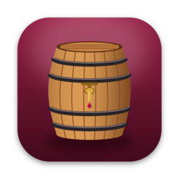
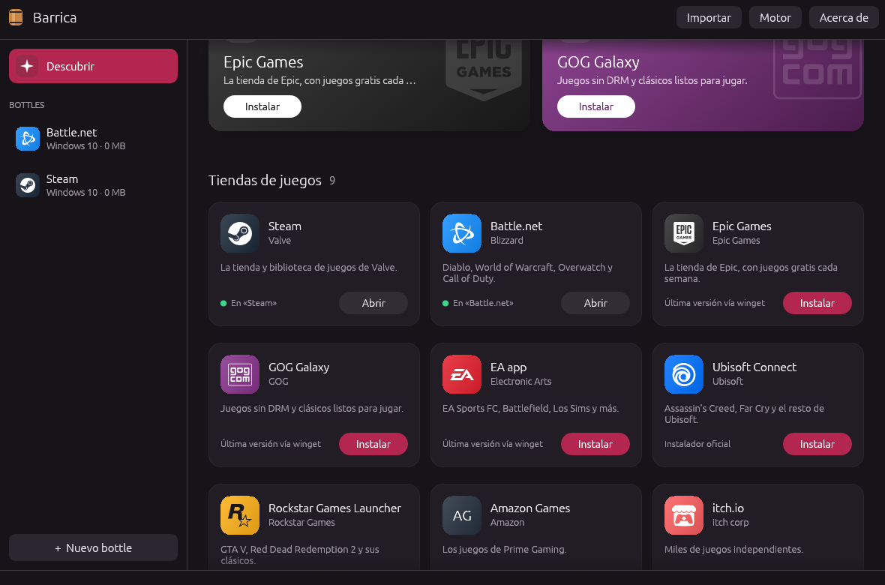
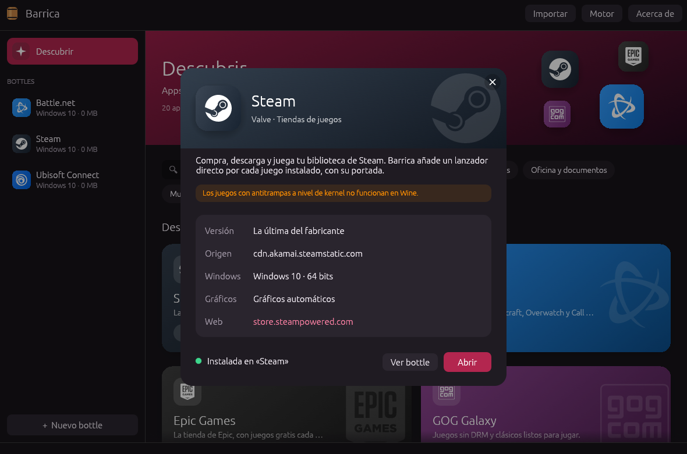
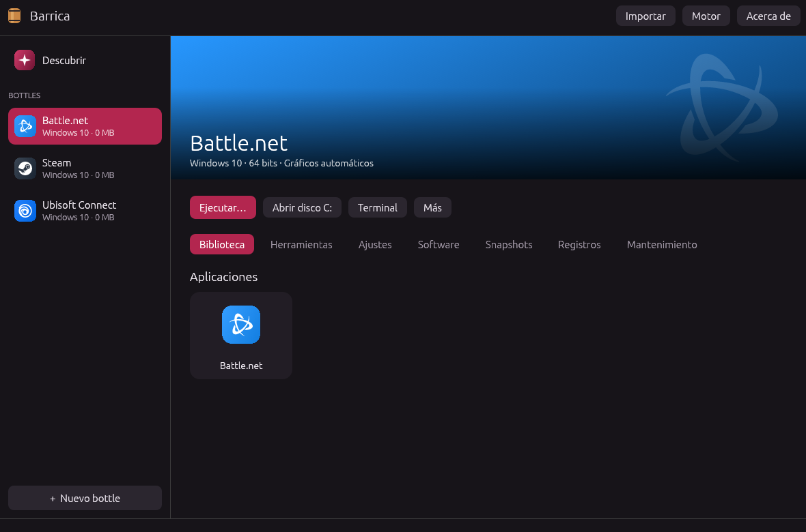
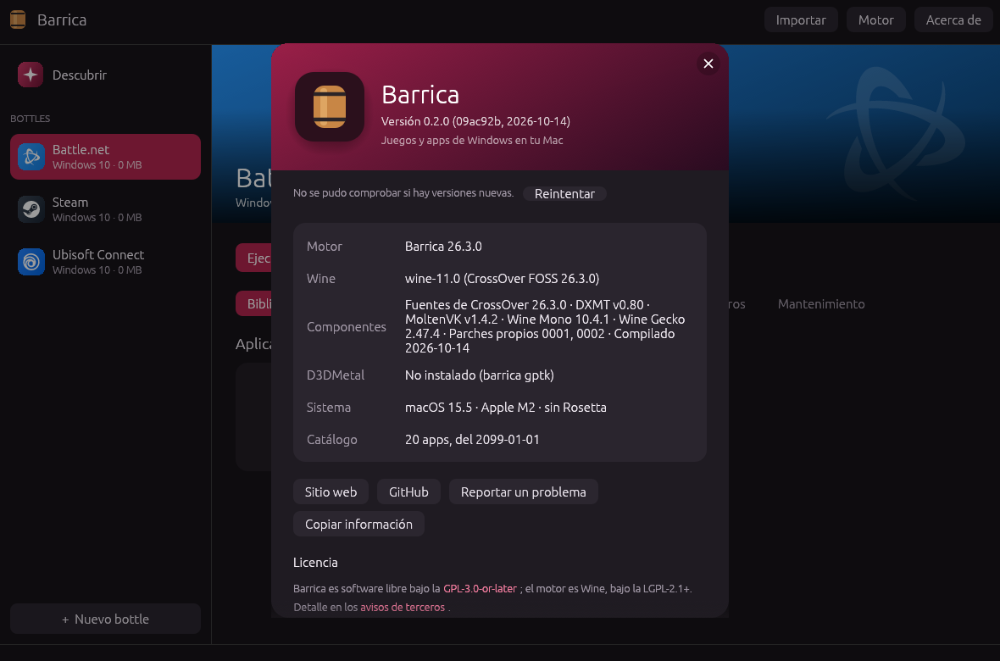

<p align="center">
  
</p>

<h1 align="center">Barrica</h1>

<p align="center">
  <b>Juegos y apps de Windows en tu Mac, con motor propio.</b><br>
  Libre, gratis y hecha para jugar.
</p>

<p align="center">
  <a href="https://github.com/ibearsmile2319/barrica/releases/latest/download/Barrica.dmg"><b>Descargar para Mac</b></a> ·
  <a href="https://ibearsmile2319.github.io/barrica/">Sitio web</a> ·
  <a href="#preguntas-frecuentes">Preguntas</a> ·
  <a href="docs/MOTOR.md">El motor por dentro</a>
</p>

<p align="center">
  <a href="https://ibearsmile2319.github.io/barrica/#video"></a><br>
  <sub>Video en alta calidad: <a href="site/video/barrica.mp4">barrica.mp4</a> · en la <a href="https://ibearsmile2319.github.io/barrica/#video">web</a></sub>
</p>

Barrica instala y abre programas de Windows en macOS. Cada programa vive en su propio **bottle**, un Windows aparte (un `WINEPREFIX` de Wine) que Barrica crea, prepara y cuida por ti. Trae su propio motor, compilado por nosotros desde el código libre de Wine, y un catálogo para instalar Steam, Battle.net, Epic y otras apps con un clic.

> **Estado:** versión 0.2, en desarrollo activo. El motor ya abre Steam y Counter-Strike 2 en un Mac con Apple Silicon. Espera asperezas y cuéntanos lo que encuentres en [Issues](https://github.com/ibearsmile2319/barrica/issues).

## Índice

- [Qué trae](#qué-trae)
- [Instalar](#instalar)
- [Primeros pasos](#primeros-pasos)
- [El motor](#el-motor)
- [Requisitos y compatibilidad](#requisitos-y-compatibilidad)
- [Preguntas frecuentes](#preguntas-frecuentes)
- [Línea de comandos](#línea-de-comandos)
- [Compilar desde el código](#compilar-desde-el-código)
- [Contribuir](#contribuir)
- [Licencia](#licencia)

## Qué trae

| | |
|---|---|
| **Descubrir** | Un catálogo de apps y tiendas de Windows (Steam, Battle.net, Epic Games, GOG Galaxy, EA app, Ubisoft Connect, 7-Zip, Notepad++…), con su logo, una ficha por app y el progreso de cada instalación. El catálogo y las versiones se actualizan solos, sin esperar a una versión nueva de Barrica. |
| **Motor propio** | Wine 11, compilado desde el código fuente libre de CrossOver 26.3, con MSync, MoltenVK, DXMT y parches propios. Viene dentro de la app. |
| **DirectX sobre Metal** | Capas gráficas por bottle: DXMT para DirectX 10 y 11, D3DMetal de Apple para DirectX 11 y 12 (lo instalas tú), y WineD3D. «Automático» elige por ti. |
| **Un bottle por app** | Cada app se instala aparte, con la versión de Windows y los ajustes que necesita. Si una falla, las demás no se tocan. |
| **Snapshots** | Guarda un bottle antes de instalar mods y vuelve atrás en un segundo. Son clones APFS: no ocupan espacio hasta que algo cambia. |
| **Biblioteca** | Tus juegos de Steam con su portada, y un acceso directo para abrir cada uno. Las apps del catálogo, con su logo. |
| **Registros** | Cada vez que algo se abre, su salida queda guardada. Cuando un juego no arranca, ya sabes dónde mirar. |
| **CrossOver** | ¿Ya lo usas? Vincula tus bottles para abrirlos desde Barrica con el motor de CrossOver, o cópialos para usarlos con el de Barrica. El original nunca se toca. |
| **Herramientas** | `winecfg`, el editor del registro, el administrador de tareas, una terminal con el entorno del bottle y una línea de comandos completa. |

<p align="center">
  
  
</p>
<p align="center">
  
  
</p>

## Instalar

1. Descarga **[Barrica.dmg](https://github.com/ibearsmile2319/barrica/releases/latest/download/Barrica.dmg)** desde la [última versión](https://github.com/ibearsmile2319/barrica/releases/latest).
2. Ábrelo y arrastra **Barrica** a **Aplicaciones**.
3. Barrica todavía no está notarizada por Apple, así que la primera vez macOS dirá que no puede comprobar al desarrollador. Para permitirla, ejecuta esto en Terminal:

   ```sh
   xattr -dr com.apple.quarantine /Applications/Barrica.app
   ```

4. Ábrela. El motor ya viene dentro: no hace falta instalar Wine aparte.

Cada versión trae también `SHA256SUMS.txt` para comprobar la descarga (`shasum -a 256 -c SHA256SUMS.txt`) y el código fuente completo del motor.

Barrica avisa sola cuando hay una versión nueva (lo ves en **Acerca de**).

## Primeros pasos

**Instalar Steam (o cualquier app del catálogo)**
1. Abre **Descubrir**, arriba a la izquierda.
2. Pulsa **Instalar** en Steam. Barrica busca la última versión, la descarga, crea un bottle llamado «Steam» con los ajustes adecuados y abre el instalador.
3. Sigue el instalador de Steam. Al terminar, la tarjeta dice **Abrir**.

**Instalar algo que no está en el catálogo**
1. Pulsa **+ Nuevo bottle**, ponle nombre y elige la versión de Windows.
2. Pulsa **Ejecutar…** y elige el instalador (`.exe` o `.msi`).
3. Lo que instale aparece en la **Biblioteca** del bottle.

**Elegir la capa gráfica**
En **Ajustes** del bottle, **Gráficos**:
- **Automático:** la recomendada.
- **DXMT:** DirectX 10 y 11, directo a Metal. Es la que mejor va con Counter-Strike 2.
- **D3DMetal:** DirectX 11 y 12, de Apple. Primero instálala (abajo).
- **WineD3D:** la de Wine, por OpenGL. Para juegos antiguos o si las otras fallan.

**Instalar D3DMetal (opcional, para DirectX 12)**
D3DMetal es de Apple y su licencia no permite incluirlo en Barrica. Baja el [Game Porting Toolkit](https://developer.apple.com/games/game-porting-toolkit/) con tu cuenta de Apple, abre su imagen «Evaluation environment for Windows games» y ejecuta:

```sh
/Applications/Barrica.app/Contents/MacOS/barrica gptk "/Volumes/Evaluation environment for Windows games 3.0"
```

**Si algo no abre**
Mira la pestaña **Registros** del bottle: ahí está la salida de cada ejecución. Para reportarlo, abre **Acerca de → Copiar información** y pégalo en un [issue](https://github.com/ibearsmile2319/barrica/issues/new) junto con el registro.

## El motor

El motor de Barrica es Wine compilado por nosotros. No es CrossOver ni contiene ninguna parte cerrada de CrossOver: parte del código fuente que CodeWeavers publica (el mismo Wine que usa CrossOver 26.3, bajo la LGPL), con estas piezas:

| Pieza | Para qué |
|---|---|
| **Wine 11** (de CrossOver 26.3) | Ejecutar programas de Windows. Lleva los parches de CodeWeavers para macOS, como MSync. |
| **DXMT 0.80** | DirectX 10 y 11 directo a Metal. |
| **MoltenVK 1.4.2** | Vulkan sobre Metal (lo usan WineD3D y vkd3d). |
| **GnuTLS, FreeType** | HTTPS dentro de Windows y fuentes. |
| **Wine Mono y Gecko** | .NET y HTML, para que los bottles nuevos no pidan descargarlos. |
| **Parches propios** | 0001: el micrófono ya no congela el juego si macOS no responde. 0002: la interfaz de Steam se ve (antes salía en negro). |

Así pasa un juego hasta tu GPU:

```
juego de Windows (x86_64) → Rosetta 2 → motor Barrica (Wine 11) → DXMT / D3DMetal / MoltenVK → Metal → GPU
```

El motor se compila con un solo script, abierto y reproducible (`engine/build.sh`). Cada versión publicada adjunta su código fuente completo. Todo el diseño, las pruebas y las mediciones están en [docs/MOTOR.md](docs/MOTOR.md).

## Requisitos y compatibilidad

| | |
|---|---|
| **Sistema** | macOS 11 o superior |
| **Mac con Apple Silicon** (M1 a M5) | Recomendado. Necesita Rosetta 2 (macOS lo ofrece la primera vez). |
| **Mac con Intel** | La app se publica también para Intel y el motor es x86_64, pero no lo hemos probado. DXMT y D3DMetal están pensados para Apple Silicon: cuenta con juegos sencillos, no con los modernos. |
| **Linux y Windows** | No. Ver la pregunta de abajo. |
| **Espacio** | Unos 1,1 GB para la app con el motor, y unos 600 MB por cada bottle nuevo, más lo que instales. |

## Preguntas frecuentes

**¿Es gratis?**
Sí, y es software libre (GPL-3.0). Puedes usarla, estudiarla, cambiarla y compartirla. Quien publique una versión modificada debe publicar también su código con la misma licencia.

**¿Funciona en Linux?**
No. Barrica está hecha para macOS: su motor usa piezas que solo existen en el Mac (Metal, Rosetta y el controlador de ventanas de macOS de Wine) y la app usa funciones de macOS, como los clones APFS para los snapshots, la Papelera y los diálogos nativos. La parte que gestiona bottles se podría adaptar algún día, pero en Linux ya hay opciones muy maduras: Steam con Proton, Lutris, Heroic y Bottles.

**¿Es CrossOver? ¿Es legal?**
No es CrossOver ni está afiliada a CodeWeavers. Wine es software libre (LGPL) y CodeWeavers publica el código fuente de su versión; la licencia de CrossOver permite expresamente compilar versiones alternativas de su Wine. Barrica nunca toca los binarios de CrossOver: si lo tienes instalado, los bottles vinculados se abren con tu CrossOver y su licencia.

**¿Qué juegos funcionan?**
Muchos de DirectX 9, 10, 11 y 12. Counter-Strike 2 funciona con el motor de Barrica y DXMT. Los juegos con antitrampas a nivel de kernel (Valorant, por ejemplo) no funcionan en Wine. Si pruebas un juego, cuéntanos cómo fue.

**¿Por qué macOS dice que no puede comprobar al desarrollador?**
Porque Barrica aún no está firmada con un certificado de Apple (cuesta 99 USD al año) ni notarizada. El código es público y cada versión se compila en GitHub Actions a partir de él. El comando `xattr` de [Instalar](#instalar) quita el aviso.

**¿Barrica envía datos a algún sitio?**
No hay telemetría. Barrica solo se conecta a internet para bajar el catálogo y los logos (de GitHub), consultar versiones en winget-pkgs (API de GitHub), descargar los instaladores que eliges y comprobar si hay una versión nueva de Barrica.

**¿Cómo añado una app al catálogo?**
El catálogo es un archivo de texto: [`catalog/catalog.toml`](catalog/catalog.toml). Añade la receta (el formato está en [catalog/README.md](catalog/README.md)) y abre un pull request. Cuando se acepta, llega a todos los usuarios sin publicar una versión nueva.

## Línea de comandos

Todo lo que hace la app se puede hacer desde Terminal:

```sh
B=/Applications/Barrica.app/Contents/MacOS/barrica
$B list                                    # bottles, tamaño y si están abiertos
$B catalog tiendas                         # apps del catálogo
$B install steam                           # la instala en un bottle nuevo «Steam»
$B run Steam ".../Steam/steam.exe" -applaunch 730
$B snapshot Steam "antes de los mods"      # y luego: $B restore Steam "antes de los mods"
$B set Steam graphics dxmt                 # auto, d3dmetal, dxmt, dxvk o wined3d
$B gptk "/Volumes/Evaluation environment for Windows games 3.0"
$B version                                 # versión, motor y sistema, para reportar errores
$B help                                    # todos los comandos
```

### Dónde guarda las cosas

| Qué | Dónde |
|---|---|
| Bottles | `~/Library/Application Support/Barrica/Bottles/<nombre>/` (WINEPREFIX + `barrica.toml`) |
| Bottles vinculados | Solo `barrica.toml` con `crossover = "<bottle>"`; los datos siguen en CrossOver |
| Snapshots | `~/Library/Application Support/Barrica/Snapshots/<bottle>/<etiqueta>/` |
| Registros | `~/Library/Application Support/Barrica/Logs/<bottle>/` |
| Capas instaladas (D3DMetal) | `~/Library/Application Support/Barrica/Layers/` |
| Otros motores | `~/Library/Application Support/Barrica/Engines/<nombre>/bin/wine` |
| Catálogo y logos | `~/Library/Application Support/Barrica/Catalog/` (caché) |
| Ajustes | `~/Library/Application Support/Barrica/settings.toml` |

`BARRICA_HOME` cambia la carpeta raíz, por ejemplo para usar otro disco.

## Compilar desde el código

Necesitas un Mac con Apple Silicon, Xcode, Rosetta, [Homebrew](https://brew.sh) y [Rust](https://rustup.rs) 1.88 o superior.

```sh
git clone https://github.com/ibearsmile2319/barrica.git
cd barrica

# 1. El motor (una vez; unos 30 minutos en un M5 Pro)
brew install bison mingw-w64 autoconf automake libtool cmake
engine/build.sh          # deja el motor en engine/dist
engine/check.sh          # prueba de humo: HTTPS y Direct3D en cada capa

# 2. La app, con el motor dentro
./bundle.sh              # target/Barrica.app (UNIVERSAL=1 para Apple Silicon + Intel)
open target/Barrica.app

# 3. Opcional: lo que se publica
tools/dmg.sh             # target/Barrica.dmg
tools/engine-sources.sh  # código fuente del motor, como exige la LGPL
```

Tests: `cargo test` (incluye un ciclo completo con un `wine` falso) y `cargo clippy --all-targets`.

**Publicar una versión:** sube `version` en `Cargo.toml`, anota los cambios en [CHANGELOG.md](CHANGELOG.md) y crea el tag (`git tag v0.2.0 && git push origin v0.2.0`). GitHub Actions compila el motor y la app, y publica la Release con el `.dmg`, el código fuente del motor y los sha256 ([`.github/workflows/release.yml`](.github/workflows/release.yml)).

### Estructura

| Ruta | Qué es |
|---|---|
| `src/core.rs` | Toda la lógica: bottles, motores, capas, ejecución, snapshots y CrossOver. Sin interfaz y con tests. |
| `src/catalog.rs` | El catálogo: recetas, versiones de winget-pkgs, descargas verificadas e instalación. |
| `src/about.rs` | Versión, información del motor y del sistema, y búsqueda de versiones nuevas. |
| `src/gui.rs`, `src/gui/` | La app (egui): `discover.rs` es Descubrir e `info.rs` es Acerca de. |
| `src/main.rs` | Sin argumentos abre la app; con argumentos funciona como línea de comandos. |
| `engine/` | El motor: `build.sh`, `patches/`, `check.sh` y `smoke.c`. |
| `catalog/` | El catálogo de apps y su formato. |
| `site/` | La web, publicada en GitHub Pages, con el video en `site/video/`. |
| `tools/promo/` | El video de presentación: `promo.html` y `render.js`, que lo graba cuadro a cuadro. |
| `docs/MOTOR.md` | Diseño, decisiones y mediciones del motor. |
| `ROADMAP.md` | Lo que falta y el plan. |

## Contribuir

Toda ayuda suma:

- **Probar juegos y apps** y contar cómo fue, con la información de **Acerca de → Copiar información**.
- **Añadir apps al catálogo** con un pull request a `catalog/catalog.toml`.
- **Código:** mira [ROADMAP.md](ROADMAP.md) y [CONTRIBUTING.md](CONTRIBUTING.md). Antes de un cambio grande, abre un issue para hablarlo.

## Licencia

**Barrica** es software libre bajo la [GNU General Public License v3.0 o posterior](LICENSE) (GPL-3.0-or-later).

- **El motor** es Wine y sigue bajo su licencia, la LGPL-2.1-or-later, igual que nuestros parches (`engine/patches/`, ver [engine/COPYING.LIB](engine/COPYING.LIB)).
- **Las demás piezas** del motor (DXMT, MoltenVK, GnuTLS, FreeType, Wine Mono y Gecko) mantienen sus licencias. El detalle, y dónde está el código de cada una, está en [THIRD_PARTY_NOTICES.md](THIRD_PARTY_NOTICES.md).
- **D3DMetal** es de Apple y no se incluye.
- **Los logos** del catálogo son marcas de sus dueños y se usan solo para identificar cada app. Barrica no está afiliada a CodeWeavers, Apple, Valve ni a ninguna otra marca.

Copyright © 2026 los autores de Barrica.
